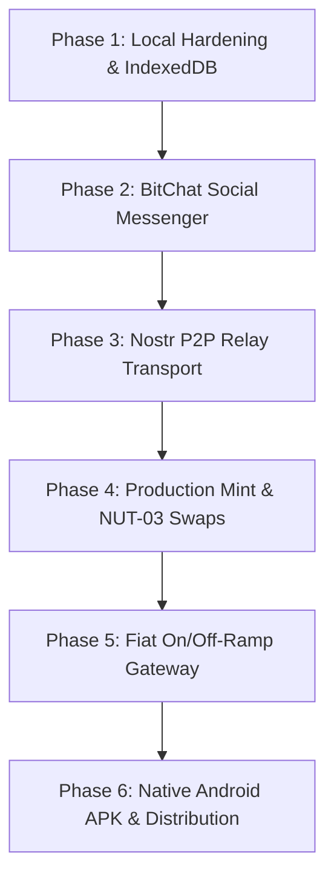

# BitFriend (BitAboki): Commercial Production Roadmap & Phased Implementation Blueprint

**Project Version:** 2.0.0 (Commercial Production Path)  
**Target Architecture:** Decentralized PWA / Capacitor Android App  
**Protocols:** Cashu (NUT-00 to NUT-09), Bitcoin Lightning (BOLT-11), Nostr (NIP-01, NIP-04, NIP-44, NIP-47, NIP-57)  
**Resumption Engine:** Antigravity Agent State Machine  

---

## 1. Executive Vision: Moving from Hackathon Demo to Live African Commerce

BitFriend is transitioning from a localized, single-device hackathon demonstration into a commercially viable, self-sovereign financial application for millions of everyday vendors and peer-to-peer users across Africa. 

### Core Architectural Pillars
1. **Zero-Custody Cashu Ecash:** Instant, private micro-transactions without high Lightning channel routing fees.
2. **"BitChat" WhatsApp-Style Social Payments:** Send and receive satoshis inline inside end-to-end encrypted chats with friends and family.
3. **Decentralized Relay Transport (Nostr):** No centralized company database or single point of failure; messages and token drops route through public and community relays.
4. **Resilient Local Security:** Hardware-backed IndexedDB encrypted at rest with user PINs via WebCrypto AES-GCM.
5. **Real-World Fiat Liquidity:** On-ramp and off-ramp bridging satoshis directly to local Nigerian Naira (OPay, PalmPay, Moniepoint) and Pan-African mobile money (M-Pesa, MTN MoMo).

---

## 2. Feature Specification: "BitChat" (Social Bitcoin Messenger)

### 2.1 The Concept
Users are intimidated by raw cryptographic addresses and hex keys. They already understand WhatsApp and Telegram. **BitChat** embeds a familiar messaging interface directly into BitFriend, allowing users to text friends and send satoshis inline as easily as sending a voice note or photo.

### 2.2 Functional Capabilities
* **Friend Contacts & Discovery:** Add contacts via QR scan, Lightning Address (`friend@bitfriend.me`), or Nostr npub/NIP-05 handle.
* **Encrypted 1-on-1 Chats:** Peer-to-peer encrypted messaging utilizing NIP-44 (xchaCha20-Poly1305) over Nostr relays.
* **In-Chat Satoshi Zaps & Vouchers:**
  * **"Send Sats" Action:** Tap the ₿ button in the chat input bar, type amount (e.g. 500 sats / ₦800), and tap send.
  * **Interactive Bearer Bubble:** An attractive in-chat bearer voucher card is rendered inside the chat thread with a 1-click **"Claim to Vault"** button.
  * **Offline Transmission:** When offline, the sender can tap **"Share via SMS/WhatsApp"** to beam the voucher string directly through the phone's native telecommunications layer.
* **Audio Voice Notes:** Quick push-to-talk voice notes with automated Hausa/English payment announcements.

---

## 3. Phased Implementation Plan & Task Breakdown

Each phase contains granular, sequential tasks with checkboxes. When an Antigravity agent or developer completes a task, the checkbox is marked `[x]` and execution progresses to the next task.



---

### Phase 1: Client Storage Hardening & IndexedDB Encryption
> **Goal:** Eliminate browser localStorage limits and secure on-device bearer tokens with PIN-derived AES-GCM encryption.

- [x] **Task 1.1:** Install and configure client-side database layer (`npm install idb` or `dexie`).
- [x] **Task 1.2:** Implement `src/utils/secureStorage.ts` with WebCrypto PBKDF2 key derivation and AES-GCM 256-bit encryption for stored proofs.
- [x] **Task 1.3:** Create a 6-digit PIN lock screen modal with auto-lock timer (after 5 minutes of inactivity).
- [x] **Task 1.4:** Migrate existing `localStorage` proofs, transaction history, and Adashi circles into encrypted IndexedDB with zero data loss.
- [x] **Task 1.5:** Add automatic database export/import integrity checksums and automated schema versioning.
- [x] **Verification 1.6:** Run `npm run build` and verify that closing the browser and clearing cookies does not destroy encrypted tokens if user has PIN/seed.

---

### Phase 2: "BitChat" Social Messenger & In-Chat Token Transfers
> **Goal:** Build the WhatsApp-style social messaging tab with inline Bitcoin zaps, audio receipts, and offline voucher bubbles.

- [x] **Task 2.1:** Create data models in `src/types/index.ts` for `ChatMessage`, `ChatContact`, and `InlinePaymentPayload`.
- [x] **Task 2.2:** Build `src/components/chat/BitChatView.tsx` with conversation list, contact roster, search bar, and unread badges.
- [x] **Task 2.3:** Build `src/components/chat/ChatConversation.tsx` with WhatsApp-style bubble rendering, timestamp formatting, and read receipts.
- [x] **Task 2.4:** Build `src/components/chat/InChatSendSatsModal.tsx` for entering satoshi amounts with instant Naira exchange rate conversion.
- [x] **Task 2.5:** Create interactive `src/components/chat/PaymentBubbleCard.tsx` displaying denomination chips, status (`pending`, `claimed`), and 1-click "Claim to Vault" handler.
- [x] **Task 2.6:** Wire BitChat as a primary navigation tab in `src/App.tsx` alongside POS, Vault, Adashi, and History.
- [x] **Task 2.7:** Implement local fallback message queue in IndexedDB so messages sent offline are cached and tagged as "Waiting for Network".
- [x] **Verification 2.8:** Verify smooth 60fps scrolling, instant local message dispatch, audio chime on send/receive, and 0 TypeScript build errors.

---

### Phase 3: Nostr P2P Relay Transport & Real Multi-Device Adashi
> **Goal:** Connect BitChat and Adashi circles to decentralized Nostr relays so users on different devices communicate in real-time without a central server.

- [x] **Task 3.1:** Install `nostr-tools` (`npm install nostr-tools`).
- [x] **Task 3.2:** Implement `src/utils/nostrClient.ts` to derive Nostr pubkey/seckey from the user's BIP-39 mnemonic seed phrase.
- [x] **Task 3.3:** Configure automatic connection pool to 3 reliable, high-speed relays (e.g. `wss://relay.damus.io`, `wss://nos.lol`, `wss://relay.primal.net`).
- [x] **Task 3.4:** Implement NIP-44 encrypted direct messaging for BitChat between contact pubkeys.
- [x] **Task 3.5:** Implement Adashi multi-device coordinator: broadcast circle state events, contribution proofs, and rotating turn notifications over Nostr channels.
- [x] **Task 3.6:** Add connection status indicator in the header (e.g. `3 Relays Connected`).
- [x] **Verification 3.7:** Test two distinct browser sessions sending live encrypted text and bearer tokens over Nostr relays.

---

### Phase 4: Production Cashu Mint & Double-Spend Protection (NUT-03)
> **Goal:** Connect to live production Cashu mints, execute automatic proof swaps on reconnect, and prevent double-spending.

- [ ] **Task 4.1:** Provision private LNbits / CDK Cashu mint on a hardened VPS with automated daily backups.
- [ ] **Task 4.2:** Fund lightning node channel liquidity (inbound/outbound) via Lightning Service Providers (LSP like Olympus/Voltage).
- [ ] **Task 4.3:** Implement NUT-03 automatic proof swapping in `src/utils/cashuEngine.ts`: when a token is received offline, immediately swap it at the mint the second internet is restored.
- [ ] **Task 4.4:** Implement NUT-07 token state verification (`/v1/checkstate`) to detect spent or pending proofs.
- [ ] **Task 4.5:** Implement Multi-Mint failover: if primary mint is unreachable, automatically route swaps through secondary mints.
- [ ] **Verification 4.6:** Execute genuine BOLT-11 Lightning invoice generation and settle with a real mobile wallet (Phoenix, Zeus, Blink).

---

### Phase 5: African Fiat On/Off-Ramp Gateway
> **Goal:** Enable vendors to cash out satoshis directly to local bank accounts (Naira, CFA, KES, GHS) and mobile money without crypto exchanges.

- [ ] **Task 5.1:** Integrate African Lightning fiat off-ramp API (e.g. Kotani Pay, Bitnob, or Blink LNURL-Withdraw).
- [ ] **Task 5.2:** Build `src/components/WithdrawToBankModal.tsx`: bank selector (Access, GTBank, OPay, PalmPay, Kuda), account number validator, and instant quote generator.
- [ ] **Task 5.3:** Build automatic settlement execution: pay Lightning invoice generated by ramp API, receive instant NIBSS/M-Pesa bank deposit confirmation.
- [ ] **Task 5.4:** Provide printable transaction receipt and SMS confirmation to vendor.
- [ ] **Verification 5.5:** Complete end-to-end sandbox test from satoshis in vault to bank account credit receipt.

---

### Phase 6: Native Android Packaging (Capacitor APK) & Offline Hardware
> **Goal:** Package BitFriend into a native Android `.apk` for direct distribution via WhatsApp, Bluetooth, and Google Play Store.

- [ ] **Task 6.1:** Install Capacitor core and Android tooling (`npm install @capacitor/core @capacitor/android @capacitor/cli`).
- [ ] **Task 6.2:** Initialize Capacitor project (`npx cap init BitFriend me.bitfriend.app`).
- [ ] **Task 6.3:** Integrate native Android plugins for persistent background service workers, preventing Android OS task killing.
- [ ] **Task 6.4:** Integrate native Android NFC plugin for seamless phone-to-phone contact tap payments.
- [ ] **Task 6.5:** Configure offline Bluetooth Low Energy (BLE) or Wi-Fi Direct transport for 100% off-grid peer-to-peer token beaming.
- [ ] **Task 6.6:** Build and sign production release APK (`npx cap build android`).
- [ ] **Verification 6.7:** Install APK on physical Android device and verify native camera, NFC, audio chimes, and offline startup.

---

## 4. Antigravity Resumption State Machine

This section allows any Antigravity AI session to resume work immediately. The agent should inspect this block, determine the current active task, execute it, and update the status.

```yaml
ANTIGRAVITY_RESUME_STATE:
  active_phase: "Phase 4: Production Cashu Mint & Double-Spend Protection (NUT-03)"
  current_task: "Task 4.3: Implement NUT-03 automatic proof swapping in src/utils/cashuEngine.ts and NUT-07 state check"
  last_checkpoint: "Phase 1, Phase 2, and Phase 3 (Nostr P2P Relay Transport & Multi-Device Adashi) completed and verified with 0 build errors."
  next_action: "Implement NUT-03 automatic proof swap on network reconnect and NUT-07 spent proof check in cashuEngine.ts"
  build_command: "npm run build"
  dev_server_command: "npm run dev"
  dev_url: "http://localhost:5173/"
```

### Agent Resumption Instructions
1. Check `active_phase` and `current_task` above.
2. Read the corresponding phase section and implement the requested file or utility.
3. Validate with `npm run build` to ensure 0 TypeScript and bundle errors.
4. Update the task checkbox to `[x]` and advance `current_task` to the next step.
5. Notify the user of progress and commit changes.
